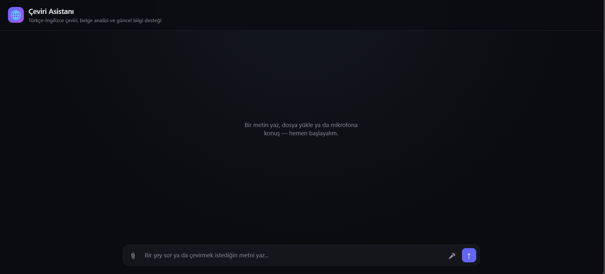
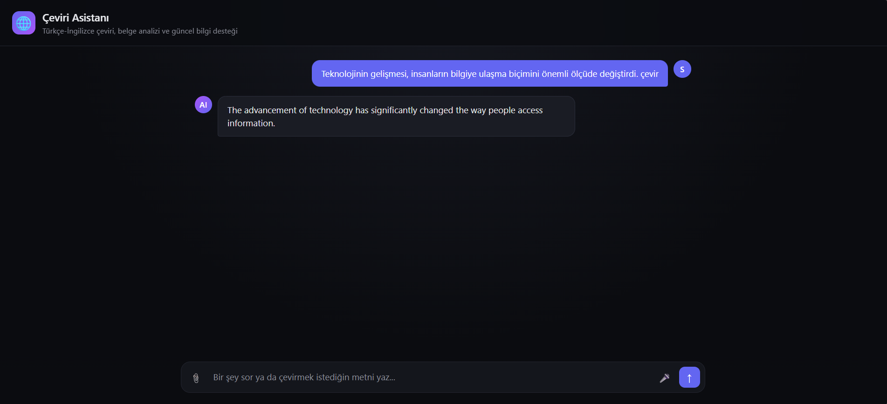
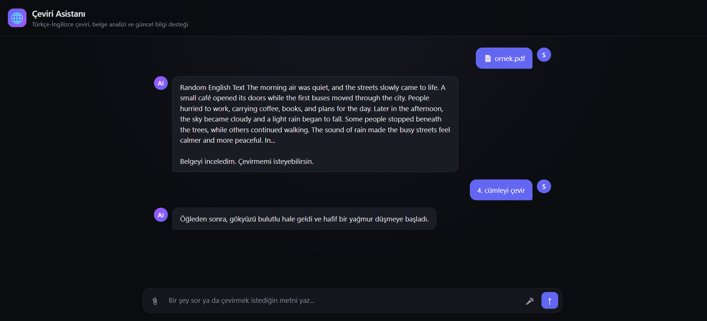
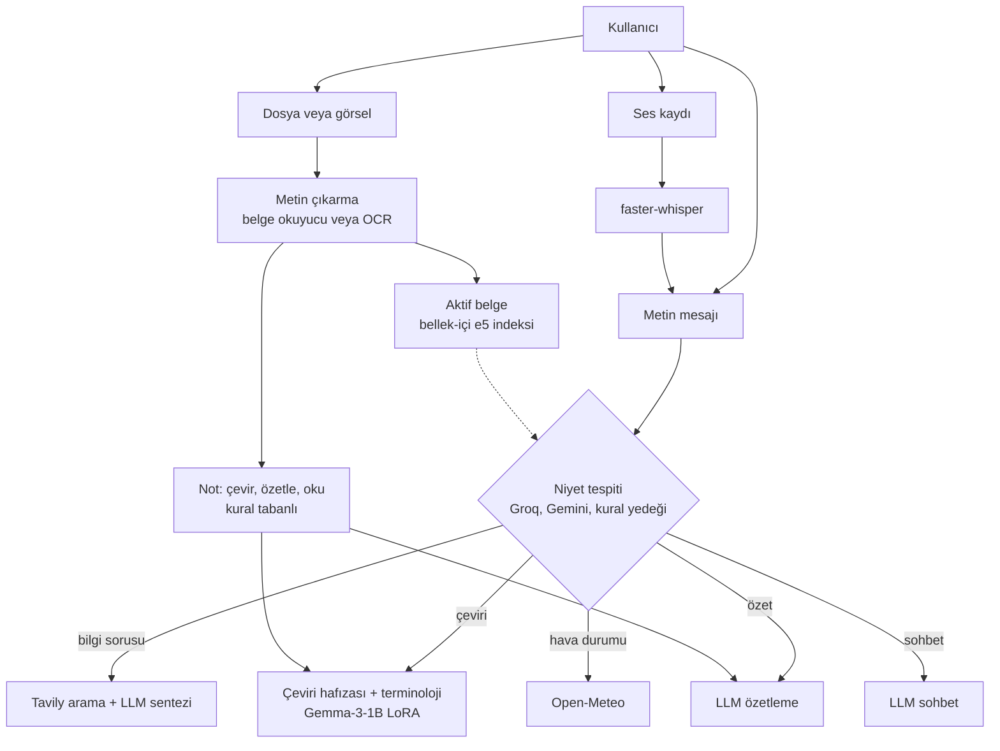

# Çeviri Asistanı

Türkçe ↔ İngilizce - İngilizce ↔ Türkçe çeviri, belge işleme, web araması ve sesli girişi tek arayüzde birleştiren yapay zekâ destekli asistan. Çeviri için LoRA ile ince ayarlanmış **Gemma-3-1B** modeli yerelde çalışır.



## Özellikler

- **Türkçe ↔ İngilizce çeviri:** LoRA ile ince ayarlanmış Gemma-3-1B. Cümleleri çevirebilir ve daha önce çevrilen cümleler çeviri hafızasından anında gelir.
- **Dosya desteği:** PDF, DOCX ve TXT okuma.
- **Görselden metin çıkarma:** EasyOCR ile görüntülerdeki metni tanıma ve çeviri akışına aktarma.
- **Belge komutları:** Yüklenen belge veya görsel üzerinde "çevir", "3. cümleyi çevir", "özetle".
- **Web destekli soru-cevap:** Tavily ile arama, LLM ile kaynakların sentezi, kaynak bağlantısı.
- **Sesli giriş:** `faster-whisper` ile konuşmayı metne çevirme. Metin göndermeden önce düzenlenebilir.
- **Niyet tespiti:** Metin mesajlarında LLM tabanlı yönlendirme (Groq, yedek olarak Gemini), her ikisi de yanıt vermezse kural tabanlı yedek.
- **Hava durumu:** Open-Meteo tabanlı güvenli kaynak bağlantısı.
- **Bağlamsal destek:** ChromaDB tabanlı terminoloji ve çeviri hafızası, `e5-small` ile belge parçası arama.

## Ekran Görüntüleri

### Çeviri


### Belge üzerinde işlem


## Sistem Mimarisi



**Veri tabanlı bileşenler:**
- *Web soru-cevap:* arama sonuçları LLM'e bağlam olarak verilir, cevap kaynak bağlantısıyla döner.
- *Terminoloji:* ChromaDB'den ilgili terimler çeviri prompt'una eklenir.
- *Çeviri hafızası:* ChromaDB'de saklanır, birebir eşleşmede model çağrılmaz.
- *Belge arama:* aktif belge parçalanıp `e5-small` ile aranır. Bu bölüm yalnızca erişim (retrieval) yapar, bulunan parça doğrudan gösterilir, LLM cevap üretmez.

## Çeviri Modeli ve Eğitim

| Özellik | Değer |
|---|---|
| Temel model | Gemma-3-1B-IT |
| Yöntem | 4-bit kuantizasyon + LoRA |
| LoRA rank | `r=16` |
| Veri kümesi | `cturan/high-quality-english-turkish-sentences` |
| Eğitim verisi | ~45 bin cümle çifti, iki yönle ~90 bin örnek |
| Epoch | 1 |
| Ortam | Google Colab T4 GPU |

### Çeviri Kalitesi

Model, eğitimde kullanılmayan **300 cümle çiftinde** greedy decoding ile temel modelle karşılaştırılmıştır.

| Yön | Model | BLEU | chrF |
|---|---|---:|---:|
| EN → TR | Temel model | 7.05 | 45.99 |
| EN → TR | LoRA ile eğitilmiş | **33.42** | **65.32** |
| TR → EN | Temel model | 7.20 | 38.25 |
| TR → EN | LoRA ile eğitilmiş | **39.55** | **65.22** |

Test cümleleri eğitim verisiyle aynı kaynaktan ve aynı dağılımdan seçilmiştir ve eğitimde görülmemiştir. Bu, WMT gibi standart bir benchmark değildir. Skorlar temel model ile ince ayarlı model arasındaki iç karşılaştırmayı gösterir ve başka sistemlerin yayımlanmış sonuçlarıyla doğrudan kıyaslanmamalıdır.

## Niyet Tespiti Testi

Elle hazırlanmış 105 örneklik test setinde (`tests/niyet_testleri.json`) LLM niyet sınıflandırıcısı **105 istekten 100'ünde** doğru sonuç verdi (%95,24). Test `niyet_belirle` fonksiyonunu doğrudan çağırır, kural tabanlı yedek mekanizma ölçüme dahil değildir. Kalan 5 istek sağlayıcı hatası veya zaman aşımı nedeniyle sonuçlanmadı.

| Niyet | Başarılı / Toplam | Oran |
|---|---:|---:|
| Çeviri | 24 / 25 | %96 |
| Hava durumu | 14 / 15 | %93,33 |
| Özetleme | 19 / 20 | %95 |
| Sohbet | 19 / 20 | %95 |
| Soru-cevap | 24 / 25 | %96 |
| **Genel** | **100 / 105** | **%95,24** |

Çalıştırmak için: `cd src && python niyet_test_calistir.py`

## Kurulum

Gereksinimler: NVIDIA GPU, Python 3.14 (3.14.7 ile test edildi). İlk çalıştırmada embedding, OCR ve ses modelleri otomatik indirilir, internet gerekir.

git clone https://github.com/Ismaildemirag/ceviri-asistani.git
cd ceviri-asistani
python -m venv .venv
.venv\Scripts\activate            # Linux/Mac: source .venv/bin/activate

# 1) Önce PyTorch (GPU sürümü)
pip install torch==2.11.0 torchvision==0.26.0 torchaudio==2.11.0 --index-url https://download.pytorch.org/whl/cu128

# 2) Sonra diğer bağımlılıklar
pip install -r requirements.txt

copy .env.example .env            # Linux/Mac: cp .env.example .env

# .env dosyasını aç, kendi API anahtarlarını yaz
hf download Ismaildemirag/gemma3-tr-en-ceviri --local-dir models/ceviri_modelim_v3
cd src
python web_app.py

Farklı CUDA sürümü için komutu https://pytorch.org/get-started/locally adresinden seç.

Windows’ta Unsloth triton ister. Hata verirse pip install triton-windows.


| Değişken | Açıklama |
|---|---|
| `GROQ_API_KEY`, `GROQ_MODEL` | Niyet tespiti ve cevap sentezi (birincil) |
| `TAVILY_API_KEY` | Web arama |
| `GEMINI_API_KEY`, `GEMINI_MODEL` | Yedek LLM sağlayıcı |

Hepsi ücretsiz katmanla çalışır. Anahtar eksikse ilgili katman atlanır, sistem alttaki katmana düşer.

**Çalıştırma:**

```bash
cd src
python web_app.py                 # http://localhost:5000
```

Çeviri hafızası boş başlar, kullandıkça dolar. İsteğe bağlı olarak `hafiza_yukle.py` ile kendi paralel veri setinden doldurulabilir.

## Proje Yapısı

```text
ceviri-asistani/
├── src/
│   ├── ai_arama.py           Groq/Gemini/Tavily istemcileri, niyet tespiti
│   ├── belge_ceviri.py
│   ├── belge_hafizasi.py     aktif belge indeksi
│   ├── belge_yukle.py        PDF/DOCX/TXT okuyucu
│   ├── cpnfig.py
│   ├── gorsel_oku.py         OCR
│   ├── hafiza_temizle.py
│   ├── hafiza_yukle.py       çeviri hafızasını veri setinden doldurur
│   ├── hava_durumu.py        Open-Meteo
│   ├── niyet_test_calistir.py
│   ├── rag_setup.py          ChromaDB koleksiyonları
│   ├── ses_tanit.py          konuşmadan metne
│   ├── terminoloji_yukle.py
│   ├── translate.py          yönlendirme, çeviri, özetleme
│   ├── web_app.py            Flask uygulaması ve API uçları
│   ├── web_arama.py          DuckDuckGo yedek arama
│   ├── static/               CSS, JS
│   └── templates/            HTML
├── tests/niyet_testleri.json
├── docs/                     ekran görüntüleri
├── .env.example
├── requirements.txt
```

## Bilinen Sınırlamalar

- **Tek kullanıcılı tasarım:** Konuşma geçmişi, aktif belge ve çeviri hafızası sunucuda global tutulur. Herkese açık bir sunucuda kullanıcılar birbirinin verisini görür, uygulama yerel kullanım içindir.
- 1B parametreli model uzun, teknik veya çok bağlamlı cümlelerde dilbilgisi ve kelime seçimi hataları yapabilir.
- Belge sorgulama ilgili parçayı gösterir, cevap üretmez.
- OCR küçük veya düşük çözünürlüklü görsellerde hata yapar.
- Web araması ve sentez kalitesi ücretsiz katman kotalarına ve kaynakların durumuna bağlıdır.
- Genel sohbet basit düzeydedir, modelin asıl amacı çeviridir.